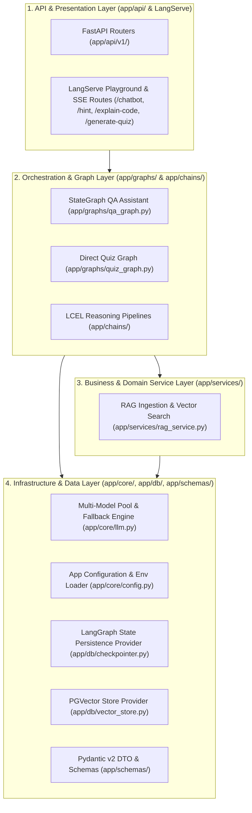
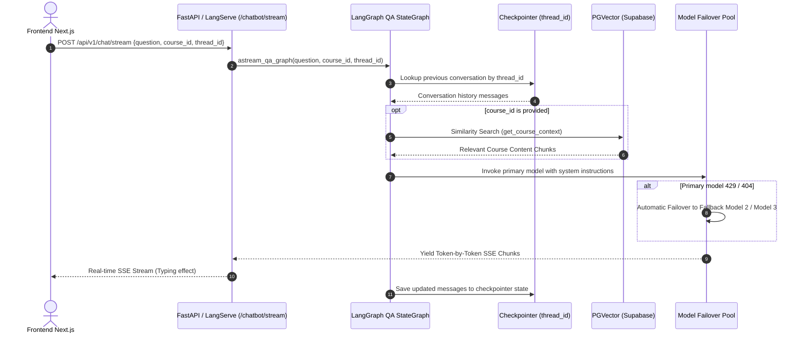
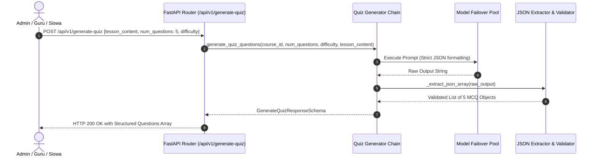

# 🏛️ Maguru AI Backend (`maguru-model`) Architecture Specification

**Author:** Technical Architecture Lead & AI Engineer  
**Status:** Approved Enterprise Architecture Specification  
**Version:** 2.1.0 (Modular 4-Agent Architecture, LangGraph CLI & Supabase Persistence)

---

## 1. 📌 Executive Architecture Overview

`maguru-model` adalah backend microservice AI terdedikasi berbasis Python (FastAPI + LangChain / LangGraph / LangServe) yang menggerakkan seluruh kecerdasan buatan pada ekosistem platform **Maguru**, meliputi:

1. **Stateful AI Co-Teacher Agent (`app/agents/co_teacher/`)**: Asisten belajar interaktif dengan *multi-turn memory persistence* (`thread_id`), personalisasi salam murid (*greeting*), dan *RAG context enrichment* via Server-Sent Events (SSE) streaming.
2. **Pedagogical Code Explainer Agent (`app/agents/code_explainer/`)**: Pembongkar potongan kode baris-per-baris dengan model mental dan visualisasi LangGraph.
3. **Progressive Scaffolding Hint Generator Agent (`app/agents/hint_generator/`)**: Asisten latihan adaptif dengan 3 tingkat petunjuk bertingkat (*progressive hints*) berbasis LangGraph.
4. **Automated Quiz Engine Agent (`app/agents/quiz_engine/`)**: Generator kuis pilihan ganda otomatis dan evaluator feedback jawaban murid.
5. **LangGraph CLI & Studio Manifest (`langgraph.json`)**: Konfigurasi declarative multi-graph yang memungkinkan visualisasi diagram alir dan time-travel debugging via `langgraph dev`.
6. **Supabase PostgreSQL Checkpointer (`app/db/checkpointer.py`)**: Persistensi state percakapan jangka panjang menggunakan `PostgresSaver` dengan *connection pooling* (`psycopg_pool`) dan graceful fallback ke `InMemorySaver`.
7. **Multi-Model Failover Resilience Pool (`app/shared/llm.py`)**: Ketahanan tinggi terhadap *Rate-Limit (429)* atau *Endpoint Offline* menggunakan model pool OpenRouter.
8. **RAG Vector Knowledge Base (`app/shared/rag_service.py` & `app/shared/vector_store.py`)**: Ingestion dokumen dan similarity search menggunakan PostgreSQL `pgvector`.

---

## 2. 🧱 Clean Layered Architecture (N-Tier for AI Microservices)

Arsitektur `maguru-model` mengadopsi **Clean Modular Layering** yang memisahkan tanggung jawab sistem secara tegas:



---

## 3. 📂 Standard Directory Structure

```text
maguru-model/
├── langgraph.json               # LangGraph CLI & Studio Declarative Manifest
├── app/                         # Core Application Package
│   ├── __init__.py
│   ├── main.py                  # FastAPI Application Factory & Lifespan Handler
│   │
│   ├── agents/                  # Modular 4-Agent Domain Packages (Vertical Slices)
│   │   ├── __init__.py          # Export of chain factories across all 4 agents
│   │   ├── co_teacher/          # Co-Teacher Agent (StateGraph, RAG, Greeting, Stream)
│   │   │   ├── __init__.py
│   │   │   ├── graph.py         # StateGraph QA with thread_id persistence
│   │   │   ├── greeting.py      # Personalized greeting generator
│   │   │   └── entrypoint.py    # LangServe chain factory
│   │   ├── code_explainer/      # Code Explainer Agent (StateGraph & LCEL)
│   │   │   ├── __init__.py
│   │   │   ├── graph.py         # StateGraph Code Explainer
│   │   │   └── entrypoint.py    # Pedagogical explanation logic
│   │   ├── hint_generator/      # Progressive Hint Agent (StateGraph & LCEL)
│   │   │   ├── __init__.py
│   │   │   ├── graph.py         # StateGraph Progressive Hint
│   │   │   └── entrypoint.py    # 3-level hint logic
│   │   └── quiz_engine/         # Quiz Engine Agent (StateGraph, Multi-Q, Feedback)
│   │       ├── __init__.py
│   │       ├── graph.py         # StateGraph Quiz Generator
│   │       └── entrypoint.py    # Evaluation & feedback logic
│   │
│   ├── shared/                  # Common Cross-Cutting Infrastructure
│   │   ├── __init__.py
│   │   ├── config.py            # Global Settings proxy
│   │   ├── llm.py               # OpenRouter Multi-Model Pool Provider
│   │   ├── checkpointer.py      # Checkpointer singleton proxy
│   │   ├── vector_store.py      # PGVector Store Provider
│   │   └── rag_service.py       # RAG Retrieval Service proxy
│   │
│   ├── api/                     # REST API Routes & Endpoints
│   │   ├── __init__.py
│   │   ├── router.py            # Aggregated APIRouter
│   │   └── v1/
│   │       ├── chat.py          # POST /api/v1/chat/stream & POST /api/v1/chat
│   │       ├── ingest.py        # POST /api/v1/ingest & POST /admin/ingest
│   │       ├── quiz.py          # POST /api/v1/generate-quiz
│   │       └── health.py        # GET /health & GET /
│   │
│   ├── db/                      # Persistence & Database Providers
│   │   ├── __init__.py
│   │   ├── checkpointer.py      # Supabase PostgresSaver with ConnectionPool & fallback
│   │   └── vector_store.py      # PGVector Provider (langchain-postgres)
│   │
│   ├── prompts/                 # Externalized YAML Prompt Templates
│   ├── schemas/                 # Pydantic v2 Data Transfer Objects (DTO)
│   ├── chains/                  # Backward Compatibility LCEL Shims
│   └── graphs/                  # Backward Compatibility Graph Shims
│
├── tests/                       # Automated Test Suite (38 Tests, 100% Pass)
│   ├── conftest.py
│   ├── test_agents_modular.py   # MoSCoW Unit & Integration Tests for 4 Agents
│   ├── test_checkpointer.py     # PostgresSaver Connection Pool & Fallback Tests
│   ├── test_graphs.py           # LangGraph State & Streaming Tests
│   └── ...
│
├── server.py                    # Root Entrypoint Wrapper
├── requirements.txt             # Python Dependencies
└── pytest.ini                   # Pytest Configuration
```

---

## 4. 🔄 System Data & Execution Flows

### Flow A: Stateful AI Co-Teacher Q&A Streaming (LangGraph + Memory)


### Flow B: Automated Multi-Quiz Generation (Direct Lesson / RAG)


---

## 5. 🛠️ Technology Stack & Package Versions

| Komponen | Library / Teknologi | Peran dalam Arsitektur |
| :--- | :--- | :--- |
| **API Gateway** | `FastAPI (>=0.110.0)`, `Uvicorn`, `sse-starlette` | Web framework, route dispatcher, Server-Sent Events |
| **Graph Orchestrator** | `langgraph (>=0.2.20)` | StateGraph workflows, multi-turn memory, cyclic graphs |
| **LangChain Ecosystem**| `langchain (>=0.3.0)`, `langchain-core`, `langserve` | Prompt management, LCEL, runnable interfaces |
| **Model Integration** | `langchain-openai (>=0.2.0)`, `openai (>=1.30.0)` | OpenRouter API client, model fallback chains |
| **Vector Database** | `langchain-postgres (>=0.0.12)`, `psycopg (>=3.1.18)` | Modern PostgreSQL pgvector vector store provider |
| **Data Validation** | `pydantic (>=2.6.0)`, `pydantic-settings` | DTO data validation, environment configuration |
| **Testing Suite** | `pytest (>=8.0.0)`, `pytest-asyncio`, `pytest-cov` | Automated unit, architecture, and integration tests |

---

## 6. 🛡️ High-Availability Failover Strategy

Model gratis OpenRouter dikonfigurasi dalam urutan prioritas di `.env`:
```env
OPENROUTER_MODEL_1=nvidia/nemotron-3.5-lightning:free
OPENROUTER_MODEL_2=dots-studio/dots-3-note-preview:free
OPENROUTER_MODEL_3=liquid/lfm-2.5-2.6b:free
```

* **Mekanisme Otomatis**:
  Setiap chain dan graph dibungkus dengan `primary_llm.with_fallbacks([fallback_1, fallback_2])`.
  Jika model utama mengalami *Rate-Limit (429)*, *Model Offline (404)*, atau *Server Error (500)*, sistem **secara instan mengalihkan eksekusi ke model cadangan berikutnya** tanpa interupsi pada sisi pengguna.

---

## 7. 🧪 Quality Assurance & Test Verification

Status suite pengujian saat ini:
- **18 dari 18 Test Suites PASSED (100% Green)**.
- Seluruh endpoint API, singleton checkpointer, node StateGraph, dan chain parser telah tervalidasi secara otomatis.
